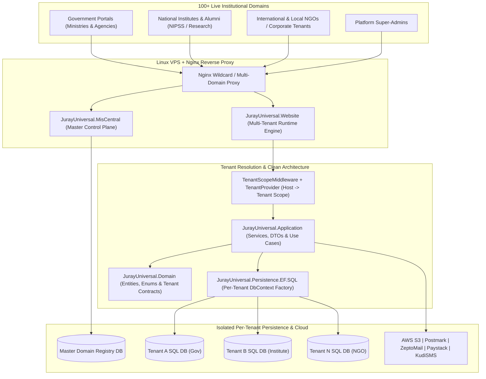

# JurayUniversal — Single-Core Multi-Tenant SaaS, CMS & E-Government MIS Engine

[](https://dotnet.microsoft.com/)
[](#multi-tenant-system-architecture)
[](#enterprise-capabilities--scale)
[](#multi-tenant-system-architecture)
[](#ci-cd--security-governance)

A flagship **.NET 8 Single-Core, Multi-Tenant Enterprise Web & Management Information System (MIS) Engine** architected to power **100+ government ministries, national institutes (including NIPSS), NGOs, and corporate portals** from a unified, centrally governed codebase—with **strict per-tenant database isolation** and a dedicated **Master SuperAdmin Control Plane (`JurayUniversal.MisCentral`)**.

---

## Enterprise Capabilities & Scale

- **100+ Institutional Websites from a Single Core**: Dynamic `Host` / domain resolution (`TenantScopeMiddleware`, `TenantProvider`) maps each incoming institutional domain to its own isolated SQL Server connection string, theme layout, and feature configuration at runtime.
- **Database-Per-Tenant Data Isolation**: Eliminates cross-tenant data leakage risks—critical for E-Government agencies, public-sector portals, and regulated NGOs—while sharing zero-overhead stateless compute.
- **Centralized Multi-Tenant Control Plane (`MisCentral`)**: Dedicated `JurayUniversal.MisCentral` administration portal enabling super-administrators to monitor, provision, and govern tenant MIS instances across domains.
- **Modular Institutional Suite**:
  - Dynamic Multi-Theme CMS (10+ enterprise layout engines, custom sections, blogs, sliders, document libraries)
  - Membership, Alumni & Cohort MIS (`GroupAlias`, `AlumniAlias`, RBAC dashboards, dues & financial tracking)
  - Training, Assessment & Digital Certificate Issuance
  - Integrated Omnichannel Communications (**Postmark**, **ZeptoMail** with retry & audit logs `MisNewsletterEmailLogs`, **KudiSMS**)
  - Multi-Gateway Collections (**Paystack**, **PixelPay**) & **Amazon AWS S3** object storage.

---

## Multi-Tenant System Architecture



---

## Solution Structure

```text
JurayUniversal/
├── .github/workflows/
│   ├── deploy-jurayuniversal.yml              # CI/CD pipeline for Multi-Tenant Website Engine
│   └── deploy-miscentral.yml                  # CI/CD pipeline for Master Control Plane (MisCentral)
├── src/
│   ├── JurayUniversal.Domain/                 # Core multi-tenant entities, MIS models, and enums
│   ├── JurayUniversal.Application/            # Business services, AWS S3, Email/SMS, and DTOs
│   ├── JurayUniversal.Infrastructure/         # TenantProvider, scope management, and cross-cutting concerns
│   ├── JurayUniversal.Persistence.EF.SQL/     # Dynamic EF Core SQL Server persistence & migrations
│   ├── JurayUniversal.Website/                # Multi-tenant Razor Pages / Areas web engine & theme layouts
│   ├── JurayUniversal.MisCentral/             # SuperAdmin multi-tenant orchestration & governance portal
│   └── PostmarkEmailService/                  # Transactional email client library
└── JurayUniversal.sln                         # Visual Studio Solution
```

---

## Technology Stack

- **Platform**: C#, .NET 8, ASP.NET Core Razor Pages & Multi-Area Architecture
- **Multi-Tenancy**: Custom Host-Header `TenantScopeMiddleware`, Scoped `TenantProvider`, Per-Tenant SQL Server Connection Routing
- **ORM & Database**: Entity Framework Core 8, Microsoft SQL Server
- **Security & Observability**: ASP.NET Core Identity (`Profile`, `AppRole`), Serilog Structured Logging, Google reCAPTCHA
- **Cloud, Messaging & Payments**: Amazon S3, Postmark, ZeptoMail, KudiSMS, Paystack, PixelPay
- **CI/CD & Hosting**: GitHub Actions (dual `rsync` pipelines preserving `.env*`), Linux `systemd` (`jurayuniversal` & `juray-miscentral`), Nginx

---

## Local Development Setup

```bash
git clone https://github.com/VS-GitHub-001/JurayUniversal.git
cd JurayUniversal

# Configure environment variables
cp src/JurayUniversal.Website/.env.example src/JurayUniversal.Website/.env
cp src/JurayUniversal.MisCentral/.env.example src/JurayUniversal.MisCentral/.env

# Restore & Build both production applications
dotnet restore JurayUniversal.sln
dotnet build src/JurayUniversal.Website/JurayUniversal.Website.csproj -c Release
dotnet build src/JurayUniversal.MisCentral/JurayUniversal.MisCentral.csproj -c Release
```

---

## Author

**Peter Emeka Onwuka**  
Chief Technology Officer & Enterprise Systems Architect  
- GitHub: [@SirP-TechHub-0904](https://github.com/SirP-TechHub-0904)  
- LinkedIn: [Peter Emeka Onwuka](https://www.linkedin.com/in/onwuka-peter-emeka)

